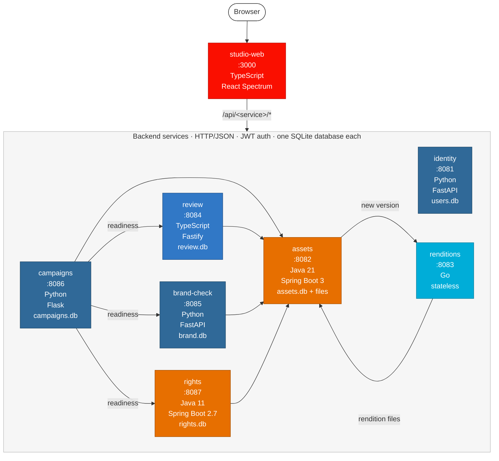

# Lumen Studio

A content supply chain application for brand and marketing teams. Designers upload creative
assets, the platform produces a rendition for every channel, a brand check scores each
version against the brand kit, reviewers approve or request changes with comments pinned on
the image, and approved renditions are packaged into campaigns.

The sample workspace belongs to **Northwind Outdoor**, a fictional outdoor apparel brand. All
data is synthetic. Seed images were generated with a Gemini image model.

## Architecture

Eight services, four languages, one SQLite database per service. Services talk over HTTP/JSON.



Box colours show the language: red for the web app, dark blue for Python, blue for TypeScript,
orange for Java, cyan for Go. Arrows show which service calls which.

- `assets` calls `renditions` (webhook) on every new version; `renditions` posts the files back.
- `review`, `brand-check` and `rights` read assets over HTTP.
- `campaigns` reads assets, review, brand-check and rights to decide readiness.
- `review` pushes new comments and decisions to open review pages over Server-Sent Events.

| Service | Stack | Owns |
|---|---|---|
| [studio-web](studio-web/) | TypeScript, React, Vite, React Spectrum | UI. Proxies `/api/<service>/*` to the backends. |
| [identity](identity/) | Python, FastAPI | Workspaces, users, roles. Issues JWTs. |
| [assets](assets/) | Java 21, Spring Boot 3 | Assets, immutable versions, tags, blobs, rendition metadata. |
| [renditions](renditions/) | Go | Channel presets. Resizes and crops each new version. |
| [review](review/) | TypeScript, Node, Fastify | Review cycles, pinned annotations, approvals (four-eyes rule), live updates over SSE. |
| [brand-check](brand-check/) | Python, FastAPI | Brand kit and compliance reports: palette and copy style rules. |
| [campaigns](campaigns/) | Python, Flask | Campaigns, deliverables, readiness, publishing manifests. |
| [rights](rights/) | Java 11, Spring Boot 2.7 | Usage rights per asset: license, channels, dates, model releases. Clearance checks. |

API contracts for every service are in [docs/api.md](docs/api.md).

### Flow

This walkthrough uses the sample data from `make seed` and covers every feature. Start the
stack and seed it first (see [Run locally](#run-locally)), then open http://localhost:3000.
Each step names the user to sign in as, because what you can do depends on your role.

| Role | Users | Can |
|---|---|---|
| designer | Leo Park, Ana Ruiz | upload assets and versions, start reviews, edit usage rights |
| reviewer | Maya Okafor, Sam Whitfield | comment on reviews, approve or request changes |
| brand_admin | Priya Natarajan | everything a reviewer can do, edit the brand kit and usage rights |

Everyone can browse the library, run brand checks, and create campaigns. To switch user, open
the avatar menu in the top right and choose **Sign out**.

#### 1. Sign in and browse the library

1. On the sign-in page, click **Leo Park** in the list of sample users. You can also type an
   email and the password `lumen-demo`.
2. The **Library** shows 12 assets. Each card has a thumbnail, the owner, the latest version,
   tags, and the status of its latest review.
3. Type `jacket` in **Search** to filter by title and description.
4. Use the **Tag**, **Owner** and **Review status** pickers to narrow the grid. Clear them to see
   all assets again.
5. The theme button next to your avatar switches between the dark and light themes.

#### 2. Upload an asset

1. As Leo, click **Upload** in the library.
2. Choose a PNG or JPEG file (25 MB at most; [samples/uploads](samples/uploads/) has images to
   try, with suggested titles and tags), enter a **Title**, and optionally a
   **Description**, comma-separated **Tags** and **Alt text**. Click **Upload**.
3. The new asset opens on its **Versions** tab as version 1.
4. Open the **Renditions** tab. Each channel preset (Instagram square, Story 9:16, Web banner,
   Email header, Thumbnail) shows **Processing** for a few seconds, then the resized image and its
   dimensions. **Download** saves one rendition.

#### 3. Add a version and compare history

1. On the same asset, open **Versions** and click **Upload new version**. Pick a file, add alt
   text, and upload. The version list now has v1 and v2. For a seeded asset, try
   `samples/uploads/beacon-headlamp-closeup.jpg` on **Beacon headlamp**.
2. Click a version in the list to preview it. **Download original** saves the uploaded file.
3. Every tab (Renditions, Brand check, Reviews) works on the version selected here.

Versions never change after upload. A new file always creates a new version.

#### 4. Run a brand check

1. Open **Night run promo** from the library and go to the **Brand check** tab.
2. The report shows an overall status, a score, and one row per rule:
   - **Palette** lists the dominant colours with their share of the image and the distance to the
     nearest brand colour. Greys, shadows and whites count as neutral. The neon magenta and cyan
     are far from the palette, so the rule fails.
   - **Copy style** checks the alt text and description for exclamation marks and all-caps words.
     "AMAZING ENERGY!!!" makes it warn.
3. Click **Run brand check** to check the selected version again, for example after uploading a
   new version or after the brand kit changes.

#### 5. Review and approve with pinned comments

1. Sign in as **Ana Ruiz** and open **Family fall hike**. On the **Reviews** tab, the open review
   is listed. Click it to open the review page.
2. Sign in as **Maya Okafor** (reviewer) and open the same review.
3. Click anywhere on the image. A numbered pin appears where you clicked and a comment box opens.
   Write a comment and click **Add comment**.
4. Hover a comment in the thread on the right to highlight its pin on the image. Pins stay on the
   same spot of the image at any window size.
5. Live updates: open the same review in a second browser window (or a private window signed in
   as another user). Comments and decisions added in one window appear in the other without a
   reload.
6. Under **Decision**, add an optional note and click **Request changes** or **Approve**.

To start a new review, open an asset with no open review, for example **Ember insulated flask**
(owned by Ana Ruiz). On its **Reviews** tab, click **Start review of version 1**. The new review
opens right away. On Family fall hike this button is disabled, because an
asset can have only one open review at a time.

Four-eyes rule: only reviewers and brand admins see the decision buttons, and the owner of an
asset cannot approve it, even as a brand admin. To see the rule, sign in as **Priya Natarajan**,
open **Compass mark** (Priya owns it), click **Start review of version 1** on the **Reviews**
tab, and click **Approve** on the review page that opens. The page shows the error from the
review service.

#### 6. Respond to requested changes

A review moves to a new version only after a reviewer asks for changes. **Ridge Jacket hero**
already went through this once: Maya requested changes on version 1, Leo submitted version 2, and
Review #1 is now **In review** on version 2. To run the cycle yourself:

1. Sign in as **Maya Okafor**, open **Ridge Jacket hero**, **Reviews** tab, and open
   **Review #1**. Add a note such as "Face still a bit dark" and click **Request changes**.
2. Sign in as **Leo Park** and open **Ridge Jacket hero**. On **Versions**, click **Upload new
   version** and upload `samples/uploads/ridge-jacket-hero-v3.jpg`. Version 3 is now selected.
3. Open the **Reviews** tab and click **Submit version 3 for review**. Review #1 moves back to
   **In review**, now on version 3, with its earlier comments kept.
4. Open the **Brand check** tab and click **Run brand check** for version 3. Campaigns need a
   brand check on the approved version (step 8).

While a review is **In review**, uploading a new version does not change the review, and **Start
review** stays disabled until the reviewer approves or requests changes.

#### 7. Record usage rights

1. Open **Family fall hike** and go to the **Rights** tab. It shows the license (licensed from
   Trailside Stock, all channels, valid until Dec 31, 2027) and that a model release is required
   but not on file.
2. **Clearance today** lists every channel. All of them are **Not cleared** with the reason
   **Model release missing**.
3. As a designer or brand admin, click **Edit rights**. Set the license type, licensor, allowed
   channels (or **All channels**), valid dates (leave **Expires on** empty for perpetual rights),
   whether a model release is required and on file, and notes. Click **Save**.
4. Check **Model release on file** for Family fall hike and save: every channel becomes
   **Cleared**.

Other examples in the sample data: **Night run promo** has a license that expired on Sep 30,
2026, **Sentier d'été trail run** is licensed for Instagram and Story only, and **Beacon
headlamp** has no rights on file.

#### 8. Build and publish a campaign

1. Sign in as **Priya Natarajan** and open **Campaigns**. Each campaign shows its status, due
   date, and how many deliverables are ready.
2. Open **Trailhead Fall 2026**. The matrix has one row per asset and one column per channel. Each
   cell is a deliverable with its status and, when it is not ready, the reasons. 5 of 6 are
   ready; Ridge Jacket hero on Story 9:16 has no approved review yet.

   A deliverable is ready when the asset has an approved review, the approved version passes the
   brand check (pass or warn), the rendition for that channel exists, and usage rights clear the
   asset for that channel today.
3. **Publish** stays disabled while any deliverable is blocked.
4. Sign in as **Maya Okafor**, open the Ridge Jacket hero review, and click **Approve**. If you
   submitted version 3 in step 6, make sure version 3 has a brand check, or the deliverable shows
   **Brand check not run**.
5. Sign in as **Priya Natarajan** again and open Trailhead Fall 2026. All 6 deliverables are
   ready. Click **Publish**.
6. The campaign is now **Published** and shows a **Manifest**: each deliverable's approved
   version and rendition, with a **Download** link. A published campaign can no longer change.
7. Open **Night Trails teaser** to see blocked deliverables: Night run promo has changes
   requested and an expired license, and Beacon headlamp has no review and no rights on file.

To create your own campaign, click **New campaign**, enter a **Name**, **Brief** and **Due date**,
and click **Create**. Under **Add deliverable**, pick an **Asset** and a **Channel** and click
**Add**. The trash icon on a deliverable removes it.

#### 9. Edit the brand kit

1. As **Priya Natarajan**, open **Brand Kit**. It shows the palette, fonts, tone of voice, logo
   rules, and the palette tolerance (ΔE) used by the palette rule.
2. Click **Edit**. Add or remove colours (name and hex), change fonts, tone of voice, logo rules
   or the tolerance, and click **Save**.
3. Run the brand check again on an asset to see the effect of the new palette or tolerance.

Other roles can view the brand kit but not edit it.

## Run locally

Requirements: Python 3.12, JDK 21+, a Java 11 JDK for `rights` (found automatically under
`/usr/lib/jvm/java-11-openjdk-*`; otherwise set `JAVA11_HOME`), Go 1.24+, Node 22+.

```bash
make setup    # venv, npm installs, go modules, assets and rights jars
make dev      # all eight services in one terminal (Procfile.dev)
make seed     # in a second terminal, once the services are up
```

Open http://localhost:3000 and pick a user. Every seeded user has the password `lumen-demo`.

| User | Role |
|---|---|
| Leo Park, Ana Ruiz | designer |
| Maya Okafor, Sam Whitfield | reviewer |
| Priya Natarajan | brand_admin |

To start over: stop the stack, `make reset`, start it again, `make seed`.

## Run with Docker Compose

```bash
docker compose up --build -d
python3 seed.py
```

## Tests

```bash
make test     # unit tests for every service
```

## Repository layout

```
lumen-studio/
├── AGENTS.md           # conventions for coding agents and contributors
├── docs/api.md         # API contracts
├── Makefile
├── Procfile.dev        # make dev
├── docker-compose.yml
├── seed.py             # loads seed/catalog.json through the public APIs
├── seed/               # catalog and generated images
├── samples/uploads/    # images for trying uploads by hand
├── tools/              # seed image generator
├── studio-web/ identity/ assets/ renditions/ review/ brand-check/ campaigns/ rights/
└── .github/workflows/  # CI
```
